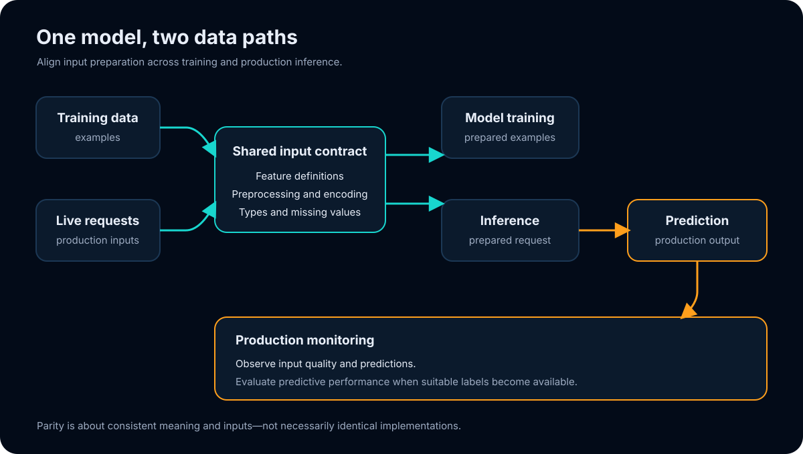
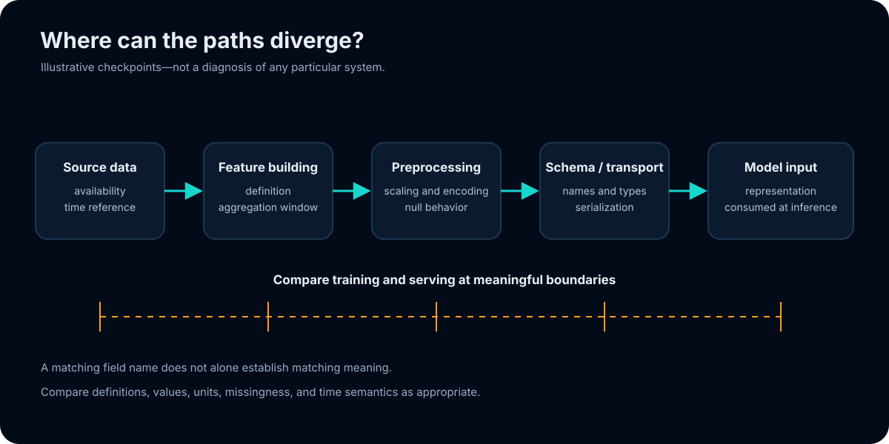
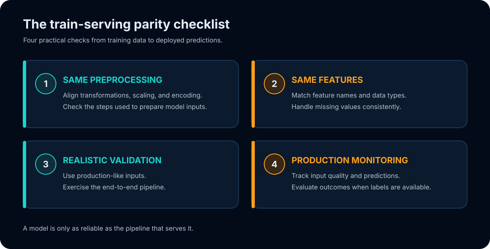
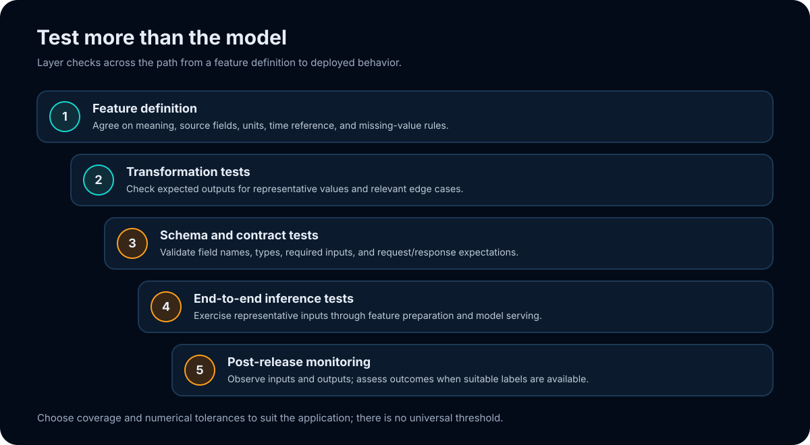
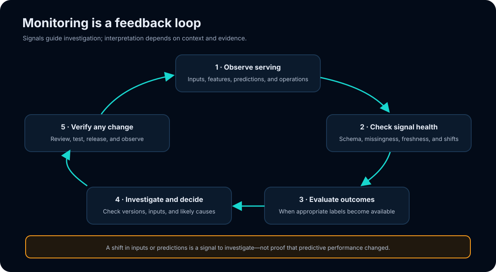

# Train–Serving Mismatch

**A practical, visual guide to keeping machine-learning inputs consistent from model development through production inference.**

[](./Train_Serving_Mismatch_Checklist_Corrected.pdf)

> **The central idea:** “A model is only as reliable as the pipeline that serves it.”

This repository accompanies a seven-slide LinkedIn carousel about train–serving mismatch. This README expands on the ideas in the carousel with illustrative examples, test considerations, and diagrams. It is general educational material—not an implementation specification, a company-specific audit, or a guarantee of model performance.

## Contents

- [The short version](#the-short-version)
- [What train–serving mismatch means](#what-trainserving-mismatch-means)
- [Where mismatches can enter](#where-mismatches-can-enter)
- [A concrete example](#a-concrete-example)
- [The four-point parity checklist](#the-four-point-parity-checklist)
- [A layered validation approach](#a-layered-validation-approach)
- [Monitoring after release](#monitoring-after-release)
- [A practical investigation workflow](#a-practical-investigation-workflow)
- [Glossary](#glossary)
- [Carousel and repository contents](#carousel-and-repository-contents)
- [Scope and limitations](#scope-and-limitations)

## The short version

A trained model expects inputs prepared according to the conventions used to build and validate it. Production inference must meet those expectations. If feature definitions, preprocessing, types, missing-value handling, or input timing differ between development and serving, the model may receive a different representation than intended.

Parity is not a requirement that every line of training and serving code be identical. It is a requirement to understand and test whether both paths produce inputs with the intended, compatible meaning.



## What train–serving mismatch means

**Train–serving mismatch** describes a difference between the data or feature representation a model sees during training or validation and the representation it receives when serving predictions. It may be introduced during data collection, transformation, feature construction, serialization, or online inference.

The distinction matters because a model does not interpret feature names and values in the abstract. It operates on the encoded inputs supplied to it. A feature that is present under a different name, scale, encoding, or time reference may no longer communicate what the model learned, even if the request appears structurally valid.

There are several related situations worth keeping distinct:

- **Train–serving skew** is a difference between training-time and serving-time inputs or transformations.
- **Data drift** is a change in the distribution or characteristics of incoming data over time. It does not, by itself, prove that training and serving implementations disagree.
- **Concept drift** is a change in the relationship between inputs and the outcome of interest. Detecting it generally requires suitable outcome labels or other domain-specific evidence.
- **A performance change** is an observed difference in predictive quality. It can have multiple causes and should not be attributed to drift or skew without investigation.

These terms are often used differently across teams. The definitions above are practical distinctions for this README, not a universal taxonomy.

## Where mismatches can enter

The following examples are hypothetical failure modes to help structure a review. They are not claims about the carousel PDF or any particular production system.

| Area | Illustrative difference | Why it can matter | Example check |
|---|---|---|---|
| **Preprocessing** | A numeric field is scaled for training but not for inference. | The model receives values on an unintended scale. | Compare transformations and test representative inputs through each path. |
| **Category encoding** | Training and serving map categories using different vocabularies or unknown-category rules. | Equivalent categories may map to different encoded inputs. | Test known, unseen, and missing categories against the agreed encoding contract. |
| **Feature construction** | One path computes a feature using a different definition, aggregation, or time window. | A value with the same label may represent something different. | Document the feature definition and compare outputs for the same source records. |
| **Schema and types** | A numeric field arrives as text, changes precision, or is renamed. | Parsing or downstream transformations can behave differently. | Validate names, types, nullability, and units at the serving boundary. |
| **Missing values** | One path imputes a missing value while another leaves it null or uses a different sentinel. | The model can interpret absence differently than intended. | Include null and sentinel cases in contract tests. |
| **Timing and freshness** | An online value is current while its training counterpart was computed at a different point in time. | The compared values may not describe the same information set. | Review timestamps, feature freshness expectations, and data availability assumptions. |
| **Serialization** | A value is rounded, reordered, or converted during transport. | The inference input may not preserve the training representation. | Test the serialized request and the deserialized model input, not only in-memory objects. |



## A concrete example

Imagine a model trained with a feature named `account_age_days`. During training, this feature is calculated as the number of days between account creation and the event timestamp. An inference service also sends a field called `account_age_days`, but calculates it using the current date instead.

The field name and numeric type can match while the meaning differs. During evaluation, both calculations might happen to use the same event-time snapshot, obscuring the issue. In production, the newer reference time can change the value seen by the model.

This example illustrates why a schema check alone may not establish semantic parity. A stronger check documents the feature definition—including its reference time—and compares training and serving outputs on the same controlled records. It does not imply that every project should use this feature or calculation.

### A small illustrative contract

```text
Feature: account_age_days
Meaning: elapsed whole days from account creation to the prediction event
Inputs: account_created_at, prediction_event_time
Type: non-negative integer, or missing if a required timestamp is unavailable
Time reference: prediction event time, not the current wall-clock time
```

This is a documentation example, not a production schema. Real contracts should use the units, null behavior, time semantics, and validation rules appropriate to the application.

## The four-point parity checklist



| Check | Questions to ask |
|---|---|
| **Same preprocessing** | Are transformations, scaling, and encoding consistent with the training path? Are their order and learned parameters handled intentionally? |
| **Same features** | Do names, definitions, types, units, missing-value behavior, and relevant time references agree? |
| **Realistic validation** | Does evaluation exercise representative inputs through the end-to-end inference path? |
| **Production monitoring** | Can the team observe relevant inputs and predictions, and evaluate outcomes when suitable labels become available? |

### 1. Same preprocessing

List the operations applied before the model receives an input: for example, parsing, normalization, scaling, encoding, or imputation. Check not only whether an operation exists in both paths, but also whether its order, parameters, and behavior on edge cases are intentional.

Some preprocessing steps learn parameters from training data. If a transformer is fitted during training, serving generally needs the appropriate fitted transformer state—not a newly estimated transformation from each request. The correct arrangement depends on the system, so verify the actual path and its contract.

### 2. Same features

Treat a feature as a definition, not just a column name. Review:

- what source information it uses and how it is combined;
- its units, type, allowed range, and null behavior;
- its reference time and any freshness expectations;
- the behavior when source fields are absent, delayed, or invalid.

Compare the values produced by the training and serving feature pipelines on the same controlled source records where practical. Differences can be intentional, but should be understood rather than silently accepted.

### 3. Realistic validation

Model-only evaluation typically assumes inputs have already been prepared. To check for pipeline mismatches, validation should also exercise the transformations and interface that will be used for inference.

Representative tests can include ordinary inputs, boundary values, nulls, unknown categories, and malformed requests, as appropriate to the application. Testing should reflect actual data contracts and avoid treating synthetic edge cases as evidence of real-world performance.

### 4. Production monitoring

After release, monitor signals that help the team understand the behavior of the deployed path. Depending on the system, these may include input schema violations, missingness, feature freshness, request failures, prediction distributions, and latency or availability.

Input or prediction changes are signals to investigate—not proof on their own that quality has improved or deteriorated. Estimating predictive performance usually depends on obtaining suitable labels, accounting for their availability delay, and choosing an evaluation method appropriate to the use case.

## A layered validation approach

No single test demonstrates every kind of parity. A useful starting point is to layer checks, from the feature definition through the actual serving interface. Select and adapt checks to the risks and constraints of the system.



| Layer | Example purpose | Possible evidence |
|---|---|---|
| **Feature definition** | Agree on the intended meaning and inputs for a feature. | Reviewed definitions, units, time reference, and missing-value rules. |
| **Transformation tests** | Check known examples and edge cases for preprocessing behavior. | Expected outputs for version-controlled fixtures. |
| **Schema and contract tests** | Check names, types, required fields, and request/response behavior. | Contract validation against representative valid and invalid payloads. |
| **End-to-end tests** | Exercise the request through feature preparation and model inference. | Reproducible tests through the serving entry point or its representative test harness. |
| **Release comparison** | Compare intended offline and serving results on controlled inputs. | Differences within a documented, application-appropriate tolerance. |
| **Production monitoring** | Observe the live system after release. | Input, feature, prediction, and operational signals, plus outcome evaluation when labels are available. |

### Comparing outputs safely

For a parity comparison, use the same underlying records and align the relevant timestamp, feature version, and model version. Compare intermediate features as well as final predictions when possible; a final-output difference alone may not identify where divergence started.

Floating-point calculations and hardware or library differences can create small numerical variations. Exact equality is appropriate only where the representation and computation require it. Otherwise define tolerances based on the feature, model, and downstream use—there is no universal tolerance suitable for every application.

## Monitoring after release

Monitoring helps assess what is happening after deployment, but it does not replace testing the pipeline before release. It is useful to distinguish different kinds of signals:

- **Input and schema signals** can reveal missing fields, unexpected types, or changing value ranges.
- **Feature signals** can reveal changes in feature availability, freshness, or distributions.
- **Prediction signals** can show shifts in output patterns; they do not establish predictive quality by themselves.
- **Operational signals** can show serving failures, latency, or resource problems.
- **Outcome signals** can support quality evaluation once appropriate ground-truth labels are available.



Define who reviews signals and what steps follow an alert. The appropriate thresholds, response time, and fallback behavior are application-specific. Avoid interpreting a single distribution shift as proof of model failure—or an unchanged distribution as proof that the system is healthy.

## A practical investigation workflow

When a discrepancy or unexpected behavior is reported, a disciplined sequence can help localize it:

1. **Reproduce the input.** Capture an approved, privacy-safe example and record the relevant model, feature, and pipeline versions.
2. **Check the request boundary.** Confirm the payload contains the expected fields, types, units, and timestamp semantics.
3. **Inspect prepared features.** Compare feature values and missingness before they reach the model.
4. **Compare transformations.** Check preprocessing order, configuration, fitted state, encoding, and null handling.
5. **Compare model inputs and outputs.** Use the same controlled input on the intended offline and serving paths.
6. **Classify the evidence.** Separate implementation skew from changing incoming data, delayed labels, model changes, and infrastructure problems.
7. **Make and verify a targeted change.** Re-run relevant contract and end-to-end tests; use the normal review and release process.
8. **Observe after release.** Review the relevant signals and outcome evaluation when labels become available.

This is a general troubleshooting aid, not an incident-response policy. Follow the organization’s privacy, access, safety, and change-management requirements when handling real production data.

## Glossary

| Term | Working definition in this README |
|---|---|
| **Feature** | A model input derived from source data or other features. |
| **Preprocessing** | Transformations used to prepare inputs for a model, such as scaling or encoding. |
| **Serving / inference** | Applying a trained model to inputs to produce predictions. |
| **Parity** | Consistency in the intended meaning and preparation of model inputs across relevant paths. |
| **Skew / mismatch** | A difference in those inputs or their preparation that may affect model behavior. |
| **Data drift** | A change in the characteristics or distribution of incoming data over time. |
| **Ground-truth label** | An observed outcome used, when appropriate and available, to evaluate predictions. |

## Carousel and repository contents

- [View or download the corrected seven-page carousel](./Train_Serving_Mismatch_Checklist_Corrected.pdf)
- [Training and serving flow diagram](./assets/train-serving-flow.svg)
- [Four-point checklist diagram](./assets/parity-checklist.svg)
- [Illustrative mismatch points diagram](./assets/mismatch-points.svg)
- [Layered validation diagram](./assets/validation-layers.svg)
- [Monitoring loop diagram](./assets/monitoring-loop.svg)

The PDF is portrait format (720 × 900 points). Its first six pages are preserved from the supplied document; the final page presents the checklist. The SVG diagrams in this README are original explanatory illustrations.

```text
.
├── README.md
├── Train_Serving_Mismatch_Checklist_Corrected.pdf
└── assets/
    ├── mismatch-points.svg
    ├── monitoring-loop.svg
    ├── parity-checklist.svg
    ├── train-serving-flow.svg
    └── validation-layers.svg
```

## Scope and limitations

- This repository is a general learning resource, not a substitute for application-specific engineering review or testing.
- The examples and diagrams are illustrative. They do not describe a particular company's system or prove that a mismatch exists.
- Semantic consistency is the goal; equivalent implementations need not use identical code.
- Monitoring signals have limitations. Input or prediction shifts do not establish performance changes by themselves.
- Outcome-based evaluation depends on suitable labels and context; labels may be delayed or incomplete.
- No invented benchmark, numerical claim, or model-performance guarantee is made here.
- This repository contains no company-specific audit material.

## Share

- Repository: [github.com/HamzaElmourabit/train-serving-mismatch](https://github.com/HamzaElmourabit/train-serving-mismatch)
- Direct PDF download: [Train_Serving_Mismatch_Checklist_Corrected.pdf](https://raw.githubusercontent.com/HamzaElmourabit/train-serving-mismatch/main/Train_Serving_Mismatch_Checklist_Corrected.pdf)
