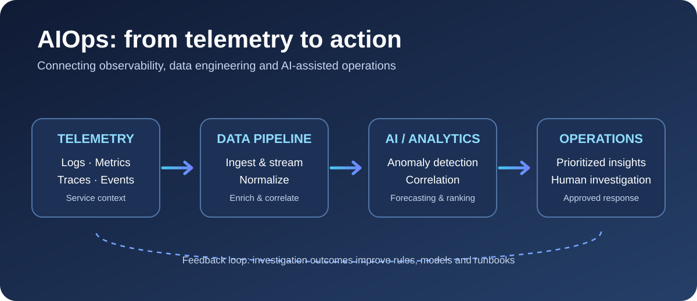
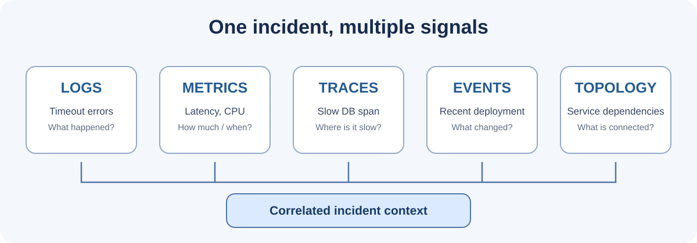
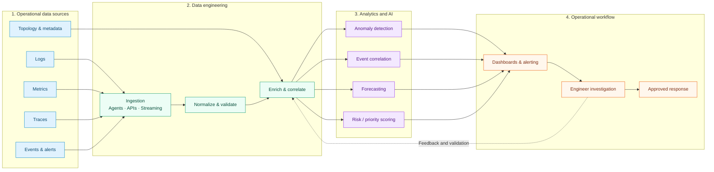
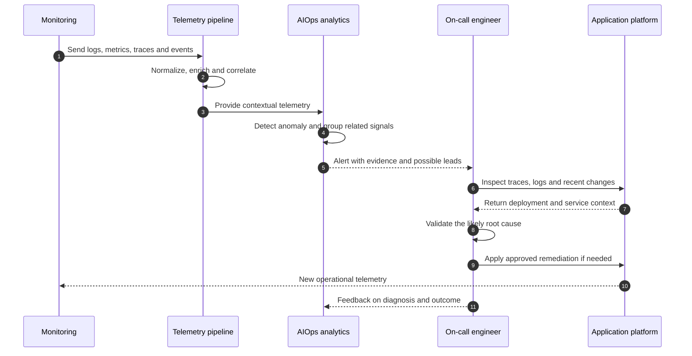
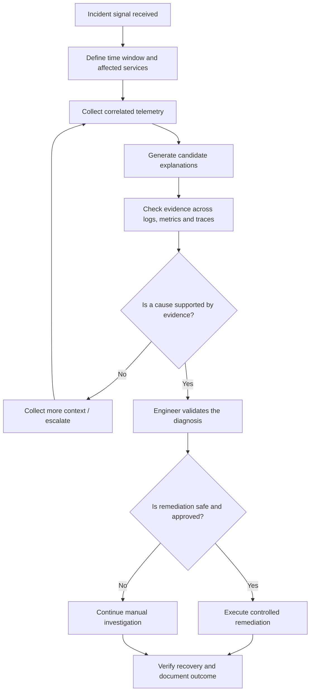

# AIOps — Artificial Intelligence for IT Operations

  

  
  
  

## 1. What is AIOps?

AIOps (Artificial Intelligence for IT Operations) refers to the use of artificial intelligence, machine learning, and data analytics to support and improve IT operations.

It helps teams make sense of large volumes of operational data generated by applications, infrastructure, networks, and services. Typical data sources include logs, metrics, traces, alerts, events, and topology metadata.

AIOps does not replace operational engineering or human decision-making. It provides analytical capabilities that can help teams detect issues earlier, prioritize incidents, and investigate complex system behavior.

## 2. Why does AIOps matter?

Modern IT environments generate more telemetry than teams can efficiently inspect manually. Monitoring systems may produce many alerts, including duplicate or low-priority signals.

AIOps can help organizations:

- Identify unusual patterns in logs, metrics, and events.
- Correlate related alerts across services and infrastructure.
- Reduce alert noise and help prioritize incidents.
- Support root cause investigation by connecting relevant signals.
- Forecast selected operational trends, such as resource utilization.
- Automate well-defined, low-risk responses when safeguards are in place.

These capabilities depend on data quality, system context, model performance, and operational validation. AIOps does not guarantee that every incident can be predicted or diagnosed automatically.

## 3. Observability data: the signals behind AIOps

AIOps relies on complementary operational signals. Each signal answers a different question, and combining them gives engineers a more complete picture.

  

| Data source | What it contains | Example | Main question |
|---|---|---|---|
| **Logs** | Discrete records of application or system activity | Error messages, authentication failures | What happened? |
| **Metrics** | Numeric measurements collected over time | CPU usage, memory, latency | How much, and when? |
| **Traces** | A request's path across distributed services | A slow API request spanning several services | Where is the request slow? |
| **Events and alerts** | Notifications about state changes or detected conditions | Service restart, threshold alert, deployment | What changed? |
| **Topology and metadata** | Relationships between infrastructure components | Service dependencies, host-to-application mapping | What is connected? |

**Key idea:** a metric may reveal that latency increased, a trace may identify the slow dependency, logs may expose related errors, and deployment events may provide useful timeline context.

## 4. Common AIOps capabilities

### Anomaly detection

Machine learning or statistical methods can identify behavior that differs from an established baseline, such as an unusual increase in response time or error rate.

### Event correlation and alert noise reduction

Related alerts can be grouped using timestamps, topology, shared attributes, or learned patterns. This can help operators focus on incidents rather than isolated notifications.

### Root cause analysis support

AIOps tools can bring together correlated logs, metrics, traces, deployment events, and dependency information to help engineers investigate possible causes. Suggested causes still require validation.

### Forecasting and capacity insights

Time-series analysis can help estimate future resource demand or identify trends that may require capacity planning.

### Incident prioritization and automation

Operational context can help rank incidents by potential impact. Automated remediation should be limited to tested actions with clear permissions, monitoring, rollback procedures, and human escalation paths.

## 5. A conceptual AIOps architecture

The following diagram illustrates a generic flow. It is a conceptual reference, not a prescription for a particular technology stack.

### Architecture stages

1. **Data collection:** collect logs, metrics, traces, events, and infrastructure metadata.
2. **Data ingestion:** stream or batch the telemetry into a processing platform.
3. **Preparation and enrichment:** normalize timestamps, parse records, remove duplicates, and enrich signals with service and topology context.
4. **Analytics and ML:** apply rules, statistical analysis, anomaly detection, clustering, correlation, or forecasting.
5. **Operational insights:** present prioritized alerts, detected patterns, and investigation context.
6. **Response and feedback:** let engineers investigate, take approved actions, and provide feedback to improve rules and models.

The architecture varies according to the organization's scale, existing monitoring stack, latency requirements, and security constraints.

## 6. Example scenario: investigating an API latency incident

Imagine an online service whose API response time suddenly increases. An AIOps workflow can correlate several clues:

- **Metrics:** API latency and CPU utilization rise.
- **Logs:** timeout messages become more frequent.
- **Traces:** requests spend more time in a database service.
- **Events:** a new application version was deployed shortly before the degradation.
- **Topology:** the affected API depends on the database service.

The timeline below shows how those signals can support an investigation. It does not establish that the deployment caused the incident.

### Example investigation checklist

- [ ] Confirm when the latency increase started.
- [ ] Compare affected and healthy service instances.
- [ ] Inspect traces to identify the slow operation or dependency.
- [ ] Search logs around the same time window.
- [ ] Review deployments, configuration changes, and infrastructure events.
- [ ] Validate the suspected cause before taking action.
- [ ] Monitor the service after remediation and record the outcome.

## 7. Root cause analysis: correlate evidence, do not guess

AIOps can rank possible explanations, but a correlation is not automatically a causal relationship. For example, a deployment occurring before an incident is a lead to investigate—not proof that the deployment caused it.

A useful investigation process is:

## 8. AIOps, MLOps, and DevOps

| Concept | Main focus | Example contribution |
|---|---|---|
| **DevOps** | Collaboration and practices for delivering and operating software reliably | CI/CD, infrastructure automation, operational practices |
| **MLOps** | Managing the lifecycle of machine-learning systems | Model training, deployment, monitoring, versioning |
| **AIOps** | Applying AI and analytics to operational data | Anomaly detection, alert correlation, incident support |

These disciplines can complement one another. MLOps practices can help manage the models used in an AIOps solution, while DevOps practices can support reliable deployment and operation.

## 9. Useful technologies to explore

The tools below are examples commonly found in observability and data platforms. They serve different roles and are not a mandatory AIOps stack.

| Technology | Typical role |
|---|---|
| [OpenTelemetry](https://opentelemetry.io/docs/) | Instrumentation and collection of telemetry |
| [Prometheus](https://prometheus.io/docs/) | Metrics collection and monitoring |
| [Grafana](https://grafana.com/docs/) | Visualization and observability dashboards |
| [Elasticsearch](https://www.elastic.co/guide/index.html) / [OpenSearch](https://opensearch.org/docs/) | Search and analysis of logs and events |
| [Apache Kafka](https://kafka.apache.org/documentation/) | Event streaming and data transport |
| [Python](https://www.python.org/doc/) | Data preparation, statistical analysis, and ML experiments |
| [MLflow](https://mlflow.org/docs/latest/index.html) | Experiment tracking and ML lifecycle management |

## 10. Challenges and good practices

- **Data quality:** incomplete, inconsistent, or poorly timestamped telemetry can produce misleading insights.
- **Context:** service dependencies and recent changes are important for interpreting signals.
- **False positives and false negatives:** detection systems need evaluation and continuous tuning.
- **Explainability:** operators need enough evidence to understand why an alert or recommendation was generated.
- **Security and privacy:** logs and traces may contain sensitive information and must be governed accordingly.
- **Safe automation:** begin with recommendations or human approval before enabling automated remediation.
- **Continuous evaluation:** monitor detection quality, operational outcomes, and changes in system behavior.

## 11. Key takeaways

- AIOps connects observability data with analytics and AI.
- Logs, metrics, traces, events, and topology provide complementary evidence.
- Data engineering is essential for reliable ingestion, normalization, enrichment, and correlation.
- AI can help detect anomalies and prioritize investigations, but human validation remains important.
- Automation should be controlled, observable, reversible, and proportionate to risk.

## Further reading

- [OpenTelemetry documentation](https://opentelemetry.io/docs/)
- [Prometheus documentation](https://prometheus.io/docs/)
- [Grafana documentation](https://grafana.com/docs/)
- [Google SRE book — Monitoring Distributed Systems](https://sre.google/sre-book/monitoring-distributed-systems/)

---

*This guide is an educational overview. The diagrams and examples are conceptual and do not claim measured performance improvements or production results.*
