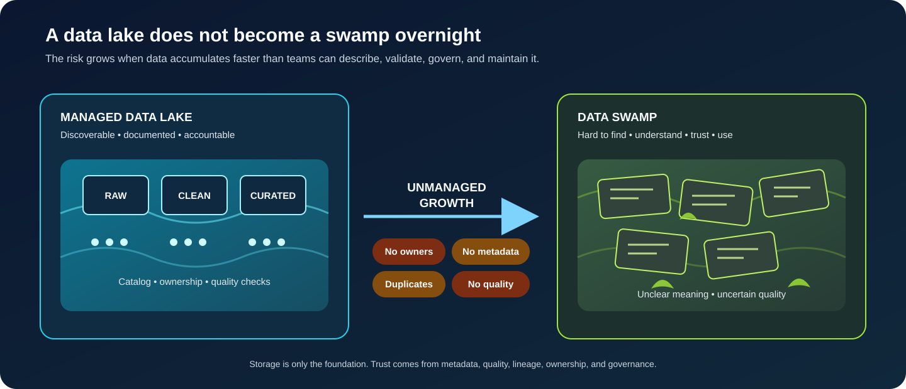

# Data Swamp

**A practical guide to understanding how a data lake can become difficult to discover, govern, trust, and use.**



> **The central idea:** A data lake stores data. Good metadata, ownership, quality controls, and governance make that data usable.

This guide accompanies the Data Swamp installment in the **Data & AI Engineering Topics** series. It expands on the visual explanation with practical causes, consequences, prevention measures, and a review checklist. The examples are illustrative; real platforms differ in architecture, scale, and governance requirements.

## Contents

- [The short version](#the-short-version)
- [What is a data swamp?](#what-is-a-data-swamp)
- [Data lake vs. data swamp](#data-lake-vs-data-swamp)
- [How a lake becomes a swamp](#how-a-lake-becomes-a-swamp)
- [Why it becomes a problem](#why-it-becomes-a-problem)
- [A practical example](#a-practical-example)
- [How to prevent it](#how-to-prevent-it)
- [A data lake health checklist](#a-data-lake-health-checklist)
- [What about a lakehouse?](#what-about-a-lakehouse)
- [Glossary](#glossary)
- [Scope and references](#scope-and-references)

## The short version

A **data lake** is a storage architecture that can hold data in different formats and at different levels of processing. A **data swamp** is an informal term for a data lake or shared data repository that has become so poorly documented, organized, governed, or maintained that people cannot reliably find, understand, trust, or use its contents.

A data lake does not automatically become a swamp just because it contains raw data, many files, or multiple formats. The problem is unmanaged complexity: data arrives without clear ownership, metadata, quality expectations, lifecycle rules, or discoverable definitions.

## What is a data swamp?

The term *data swamp* describes a repository where data may technically exist but its meaning, origin, quality, freshness, and intended use are unclear.

Typical symptoms include:

- **Unknown meaning:** table or file names do not explain what the data represents.
- **Missing metadata:** schemas, descriptions, business definitions, and tags are incomplete.
- **Unclear ownership:** nobody knows who is responsible for a dataset or who can answer questions about it.
- **Uncertain quality:** completeness, validity, duplicates, and freshness are not measured consistently.
- **Weak lineage:** users cannot easily trace where data came from or which transformations produced it.
- **Uncontrolled duplication:** multiple copies or versions exist without a clear authoritative source.
- **Unclear access and retention:** permissions, sensitive-data handling, and lifecycle policies are inconsistent.

A repository can have some of these issues without being completely unusable. Think of a data swamp as a spectrum of declining discoverability and trust, not a formal technical product category.

## Data lake vs. data swamp

| Dimension | Well-managed data lake | Data swamp symptoms |
|---|---|---|
| **Discovery** | Catalogued datasets with searchable descriptions | Users rely on tribal knowledge or guesswork |
| **Metadata** | Schemas, owners, definitions, and tags are maintained | Metadata is missing, stale, or inconsistent |
| **Data quality** | Expectations and checks are defined for important datasets | Quality is unknown or discovered too late |
| **Lineage** | Sources and transformations can be traced | Data origin and transformation history are unclear |
| **Ownership** | Responsibilities and support contacts are known | No clear person or team is accountable |
| **Access** | Permissions follow documented policies | Access is overly broad, inconsistent, or unclear |
| **Lifecycle** | Retention, archival, and deletion are managed | Old, duplicate, or obsolete data accumulates |

The distinction is not about the storage technology. The same object store, file format, or cloud platform can support either a well-managed lake or a poorly managed repository.

## How a lake becomes a swamp

A common path looks like this:

1. **Data is ingested quickly.** Teams prioritize landing data over documenting it.
2. **Metadata is postponed.** Schemas, business definitions, owners, and source details are not captured consistently.
3. **Pipelines multiply.** Different teams create overlapping datasets and transformations.
4. **Quality remains invisible.** No agreed checks exist for critical fields, freshness, or duplicates.
5. **Trust declines.** Users cannot tell which dataset is authoritative or fit for a particular purpose.
6. **Adoption slows.** Analysts and engineers spend more time investigating data than using it.

This is not inevitable. A lake can hold raw and exploratory data responsibly when it has clear conventions, discoverability, controls, and lifecycle management.

## Why it becomes a problem

| Problem | Practical consequence |
|---|---|
| **Low discoverability** | Teams spend time searching for data or rebuilding datasets that already exist. |
| **Unclear semantics** | Two teams may interpret the same field or metric differently. |
| **Uncertain quality** | Reports, analytics, and model features may be built on unsuitable inputs. |
| **Weak lineage** | Changes and incidents are harder to investigate; impact analysis becomes difficult. |
| **Duplicate datasets** | Storage and compute may be wasted, and results can disagree across teams. |
| **Unclear access controls** | Sensitive information may be exposed to users who do not need it. |
| **Poor lifecycle management** | Stale or unnecessary data remains available and increases operational burden. |

The most important consequence is often **loss of trust**. If users cannot determine what a dataset means, where it came from, whether it is current, or whether it is fit for purpose, simply storing more data creates little value.

## A practical example

Imagine an organization collects customer interaction data from a website, mobile application, and support platform.

Over time, teams upload files such as:

```text
/customer/
/customer_final/
/customer_final_v2/
/customer_latest_really_final/
/support_export/
/support_export_new/
```

The folders contain overlapping records, but the documentation does not explain:

- which source system produced each dataset;
- whether timestamps use the same timezone;
- how customer identifiers are matched;
- whether deleted or updated records are reflected;
- which dataset is approved for reporting;
- who owns the pipeline and validates its output.

A data analyst may choose a file based on its name rather than a documented contract. A machine-learning engineer may train on a different version. Both teams can produce technically valid outputs that disagree.

The solution is not merely to rename folders. The organization needs dataset ownership, clear definitions, metadata, lineage, quality checks, access rules, and a discoverable way to identify trusted data products.

## How to prevent it

There is no single tool that automatically prevents a data swamp. Tools can support good practices, but the operating model and responsibilities matter just as much.

### 1. Establish ownership

Assign a responsible owner or steward to important datasets. Make it clear who maintains definitions, answers questions, approves changes, and responds to quality issues.

### 2. Capture useful metadata

For datasets that matter, document at least:

- business description and intended use;
- source system and ingestion method;
- schema, field definitions, and units;
- owner or responsible team;
- update frequency and freshness expectation;
- sensitivity classification and access conditions;
- retention or lifecycle expectations.

Metadata should be maintained as part of the pipeline or dataset lifecycle where practical, not left as a one-time manual exercise.

### 3. Make lineage discoverable

Record the relationship between source data, transformations, and published datasets. Lineage helps users understand origin and impact when upstream data or pipelines change.

### 4. Define data quality expectations

Choose checks based on the dataset's purpose. Examples include:

- required fields are not unexpectedly null;
- identifiers meet uniqueness expectations where applicable;
- values fall within valid domains or ranges;
- records arrive within an agreed freshness window;
- referential relationships meet documented expectations.

A failed check should have a clear response: alert, quarantine, block publication, or document an accepted exception depending on the risk.

### 5. Organize data intentionally

Use zones or layers to communicate data lifecycle and readiness. A common pattern is:

- **Raw / Bronze:** source-aligned data, retained with ingestion context.
- **Cleansed / Silver:** validated, standardized, and deduplicated data.
- **Curated / Gold:** datasets shaped for defined analytical or operational use cases.

These names are conventions, not universal requirements. Define what each layer means in your own platform and avoid treating a layer name as proof of quality.

### 6. Apply access and lifecycle policies

Use least-privilege access, classify sensitive data, and define retention, archival, and deletion rules. Review permissions as teams, projects, and data uses change.

### 7. Monitor the platform

Track pipeline failures, freshness, schema changes, quality results, catalog coverage, and usage where appropriate. Monitoring should help owners act on problems rather than generate alerts nobody owns.

## A data lake health checklist

Use this as a starting point for a review. Adapt it to the platform and the sensitivity of the data.

| Review question | Why it matters |
|---|---|
| Can users find important datasets in a catalogue? | Supports discovery and reduces duplicated effort. |
| Does each critical dataset have an owner? | Establishes accountability. |
| Are schemas and business definitions documented? | Reduces ambiguity and inconsistent interpretation. |
| Is the source and transformation lineage available? | Supports traceability and impact analysis. |
| Are quality expectations defined and checked? | Makes reliability measurable. |
| Is freshness visible? | Helps users decide whether data is current enough. |
| Are access rules and sensitive-data classifications clear? | Supports appropriate data protection. |
| Are retention and deletion rules implemented? | Prevents indefinite accumulation. |
| Is there a process for schema changes and breaking changes? | Helps downstream users prepare for change. |
| Are alerts routed to a responsible team? | Makes monitoring actionable. |

A checklist score is not a certification. Prioritize gaps according to business impact, data sensitivity, and the consequences of using incorrect or stale data.

## What about a lakehouse?

A **lakehouse** combines aspects of data lakes and data warehouses, often using table formats and metadata layers to support more reliable data management and analytics on data-lake storage.

A lakehouse architecture can provide capabilities such as table-level metadata, schema evolution, transactions, and snapshots, depending on the technologies used. These capabilities can help with consistency and manageability.

However, a lakehouse is not automatically governed. It can still suffer from unclear ownership, weak definitions, poor access practices, missing quality checks, and unreliable pipelines. Architecture helps, but it does not replace data management.

## Glossary

| Term | Working definition |
|---|---|
| **Data lake** | A repository designed to store data in varied formats, often at different levels of processing. |
| **Data swamp** | An informal term for a repository whose contents are difficult to discover, understand, trust, or use. |
| **Metadata** | Information that describes data, such as its schema, meaning, source, owner, and update frequency. |
| **Data lineage** | The traceable path from data sources through transformations to downstream datasets or outputs. |
| **Data quality** | The degree to which data meets requirements for its intended use. |
| **Data governance** | The roles, policies, processes, and controls that guide how data is managed and used. |
| **Data stewardship** | The practical responsibility for maintaining and improving data definitions, quality, and appropriate use. |
| **Lakehouse** | An architecture that brings data-lake storage together with warehouse-like data management and analytics capabilities. |

## Scope and references

This README is an educational overview. It does not prescribe a specific cloud provider, catalogue, governance framework, or medallion implementation. Select controls based on your organization's legal obligations, architecture, data risks, and operating model.

Further reading:

- [AWS — What is a data lake?](https://aws.amazon.com/big-data/datalakes-and-analytics/what-is-a-data-lake/)
- [Microsoft Learn — Data governance in Microsoft Purview](https://learn.microsoft.com/en-us/purview/)
- [Apache Iceberg documentation](https://iceberg.apache.org/docs/latest/) — an example of an open table format that supports reliable table management; it is not a complete governance solution.

## Related topics

- [Data Quality](../data-quality/README.md) — defining and checking whether data is fit for purpose.
- [Data Governance and Data Stewardship](../data-governance/README.md) — ownership, policies, and accountability.
- [Apache Iceberg](../apache-iceberg/README.md) — table format capabilities for data lake architectures.
- [Train–Serving Mismatch](../train-serving-mismatch/README.md) — keeping model inputs consistent between development and production.

---

Part of [Data & AI Engineering Topics](../../README.md).
